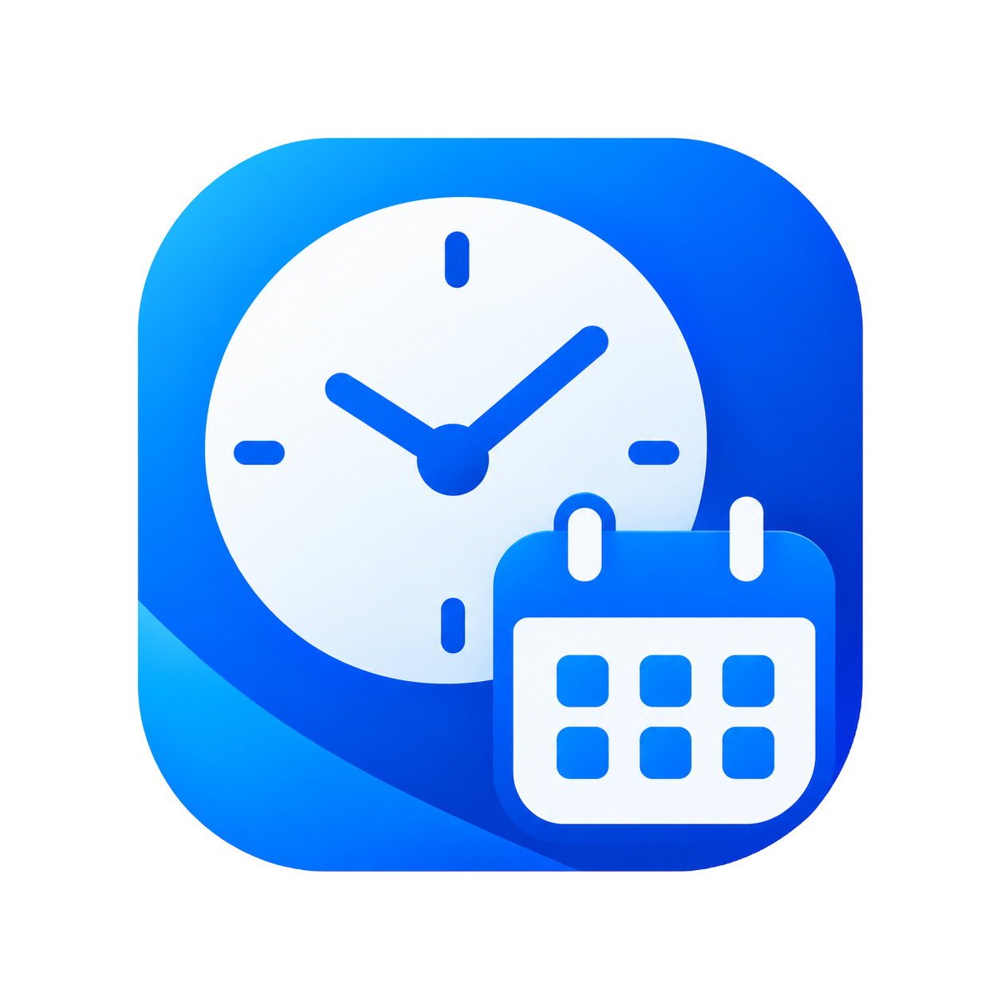

<p align="center">
  
</p>

<h1 align="center">PrimeWidget for Windows</h1>

<p align="center">
  <a href="https://microsoft.com/windows"></a>
  <a href="https://dotnet.microsoft.com/"></a>
  <a href="LICENSE"></a>
  <a href="#architecture"></a>
</p>

<p align="center">
  A native, high-performance, glassmorphic desktop widget application for Windows. Features simultaneous <b>Gregorian &amp; Ethiopian (ዓ.ም.) calendars</b>, customizable <b>Analog &amp; Digital clocks</b>, <b>World Clocks</b>, native <b>Windows 11 Acrylic &amp; Mica backdrops</b>, a built-in <b>Focus / Pomodoro timer</b>, and <b>acoustic hourly chimes</b>.
</p>

<p align="center">
  <i>Built with a <b>zero-dependency philosophy</b>: 100% pure C# / WPF and native Win32/DWM APIs.</i>
</p>

---

## ✨ Features

### 1. Dual Analog & Digital Clocks
* **Combined View**: Side-by-side presentation with a smooth analog dial on the left and a bold digital clock on the right.
* **Analog Only**: Minimalist vector dial with sweeping second hand. Supports four numeral styles:
  * Minimalist Ticks
  * Ethiopian Ge'ez (`፲፪`, `፫`, `፮`, `፱`)
  * Roman Numerals (`XII`, `III`, `VI`, `IX`)
  * Modern Digits (`12`, `3`, `6`, `9`)
* **Digital Only**: Large modern typography with seconds indicator, period tag, day name, and date badges.

### 2. Dual Calendar System (Gregorian + Ethiopian ዓ.ም.)
* **Dual Calendar Mode**: Displays Gregorian and Ethiopian dates side by side simultaneously.
* **Ethiopian Calendar Accuracy**: Full 13-month Ge'ez conversion (12 months of 30 days + Pagumē 5/6 days) with full leap year calculations.
* **Ge'ez & Amharic Localization**:
  * Date in Amharic: e.g., `ሰኞ • Nov 23, 2026 • ኅዳር 14, 2019 ዓ.ም.`
  * Ge'ez numerals or Arabic numerals toggle.
* **Traditional Ethiopian 12-Hour Cycle**: Option to display time in traditional Ethiopian daytime/nighttime cycle (sunrise 6:00 AM = 1:00 Day / 1 ሰዓት ከቀኑ).

### 3. Chronological World Clocks
* **Uniform Frosted Glass Pills**: Clean 2-column layout with subtle translucent glass borders (`#18FFFFFF`).
* **West-to-East Chronological Sorting**: Clocks automatically sort by UTC offset from West (New York) to East (Abu Dhabi).
* **Search & Management**: Add any world timezone from the built-in search list, reorder, or remove.

### 4. Native Windows 11 Glassmorphism & Themes
* **Native DWM Backdrops**:
  * **Acrylic**: Real-time desktop wallpaper blur.
  * **Mica**: Subtle wallpaper tint matching modern Windows 11 surfaces.
  * **Mica Alt**: Tabbed surface variant.
  * **Glass Tint Only**: Pure software frosted glass with opacity control down to **0% (true floating borderless text)**.
* **OS Dark/Light Theme Sync**: Dynamically switches between dark and light glass based on Windows system color preference (`AppsUseLightTheme`).
* **Vectorial Scaling**: Scalable layout from 70% to 150% with one-click presets (**Compact 85%**, **Standard 100%**, **Hero 125%**).
* **Responsive 13-Inch Compatibility**: Settings automatically clamp within work area bounds so the interface never spills off compact laptop screens.

### 5. Desktop Ergonomics & Productivity
* **Ghost / Click-Through Mode (`WS_EX_TRANSPARENT`)**: Pass mouse clicks directly through the widget onto desktop icons and windows below. Toggle anytime via system tray or Settings.
* **Glance Hotkey (`Win + Alt + W`)**: Smoothly brings the widget above all windows for a 5-second glance, then returns it to desktop level.
* **Focus / Pomodoro Timer**: Switch into a distraction-free Pomodoro session (15m, 25m, 45m) with animated glowing progress and completion notification.
* **Hourly Chime (የሰዓት ደወል)**: Synthesizes acoustic chimes on the hour (Acoustic Bell, Crystal Digital, Church Bell) with configurable quiet hours.

---

## 🚀 Installation & Running

### Option 1: Automated Installer (Recommended)
1. Download the latest release.
2. Right-click `Install-PrimeWidget.bat` and select **Run as administrator** (or double-click; it will self-elevate).
3. The script automatically trusts the application certificate machine-wide and launches the setup wizard.

### Option 2: Portable Run
Double-click `run.bat` in the project root directory or execute `publish\PrimeWidget.exe`.

---

## 🛠️ Building from Source

### Prerequisites
* **Windows 10** (build 1809+) or **Windows 11**
* **[.NET 8.0 SDK](https://dotnet.microsoft.com/download/dotnet/8.0)** or later
* **PowerShell 7** (`pwsh`) or Windows PowerShell 5.1

### Clone & Build
```powershell
# 1. Clone the repository
git clone https://github.com/DaveHR1998/PrimeWidget.git
cd PrimeWidget

# 2. Build the main application
dotnet build src/PrimeWidget/PrimeWidget.csproj -c Release

# 3. Run the application
dotnet run --project src/PrimeWidget/PrimeWidget.csproj
```

### Full Release Package & Installer
To compile the application, package the installer payload, and produce `dist\PrimeWidget-Setup.exe`:
```powershell
powershell -ExecutionPolicy Bypass -File .\build_and_sign.ps1
```
*(If `PrimeWidgetCert.pfx` is present, the script signs the binaries; otherwise, it creates an unsigned development build).*

### Running Automated Tests
The repository includes 28 automated tests covering asset integrity, calendar conversions, Ge'ez numerals, timezones, serialization, and runtime smoke tests:
```powershell
pwsh -File .\run_all_tests.ps1
```

---

## 🏛️ Architecture

PrimeWidget is built with strict adherence to the **MVVM (Model-View-ViewModel)** design pattern with zero external NuGet dependencies:

```
┌────────────────────────────────────────────────────────┐
│                      PRIMEWIDGET                       │
└───────────────────────────┬────────────────────────────┘
                            │
    ┌───────────────────────┼───────────────────────┐
    ▼                       ▼                       ▼
┌──────────────┐     ┌──────────────┐     ┌──────────────────────┐
│  WPF Views   │◄────┤  ViewModels  ├────►│  Models & Settings   │
│  & Controls  │     │ (MVVM Logic) │     │ (JSON Persistence)   │
└──────────────┘     └───────┬──────┘     └──────────────────────┘
                             │
                             ▼
                 ┌──────────────────────┐
                 │   Services & Win32   │
                 │ • Backdrop (DWM)     │
                 │ • Theme Engine       │
                 │ • Calendar Converter │
                 │ • Chime Synthesizer  │
                 │ • Global Hotkey      │
                 │ • Native Tray Icon   │
                 └──────────────────────┘
```

* **Direct3D Composition**: All dials, hands, and blur cards are vector XAML shapes rendered via GPU acceleration.
* **Low Memory Footprint**: Idles at ~35–45 MB RAM and 0.0% CPU between second ticks.

---

## 🤝 Contributing

Contributions, feature requests, and bug reports are welcome!
1. Fork the Project
2. Create your Feature Branch (`git checkout -b feature/AmazingFeature`)
3. Commit your Changes (`git commit -m 'Add some AmazingFeature'`)
4. Push to the Branch (`git push origin feature/AmazingFeature`)
5. Open a Pull Request

---

## 📄 License

This project is licensed under the **MIT License** — see the [LICENSE](LICENSE) file for details.
